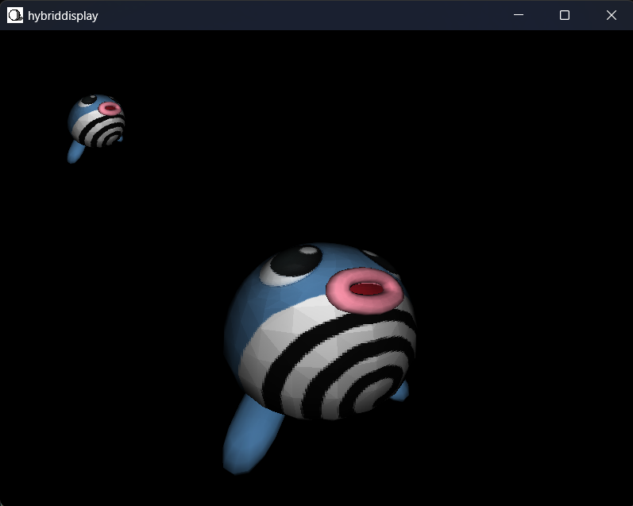

*Hi there*  
👋 Welcome to my profile 🙂  

# About Me✨
- 📖 I am a Computer Science Student at Dalhousie University in Halifax, NS.
- 💼 I am currently a Junior Financial Analyst for the Department of Fisheries and Oceans Canada.
- 🖼️ Passionate about computer graphics.
- 🎬 Watch my YouTube Short on [lambertian diffuse lighting](https://www.youtube.com/shorts/YqueCP1wgCw)

  

# What I'm Up To 🤔💭

##   [hybriddisplay](https://github.com/pearsonkai/hybriddisplay)
- 3rd Rendering Engine
- Written in C++ w/ help from SDL3
- [Web Assembly Demo](https://pearsonkai.github.io/hybriddisplay/) Available Now!!

<!--
**pearsonkai/pearsonkai** is a  _special_ ✨ repository because its `README.md` (this file) appears on your GitHub profile.

Here are some ideas to get you started:

- 🔭 I’m currently working on ...
- 🌱 I’m currently learning ...
- 👯 I’m looking to collaborate on ...
- 🤔 I’m looking for help with ...
- 💬 Ask me about ...
- 📫 How to reach me: ...
- 😄 Pronouns: ...
- ⚡ Fun fact: ...
-->
